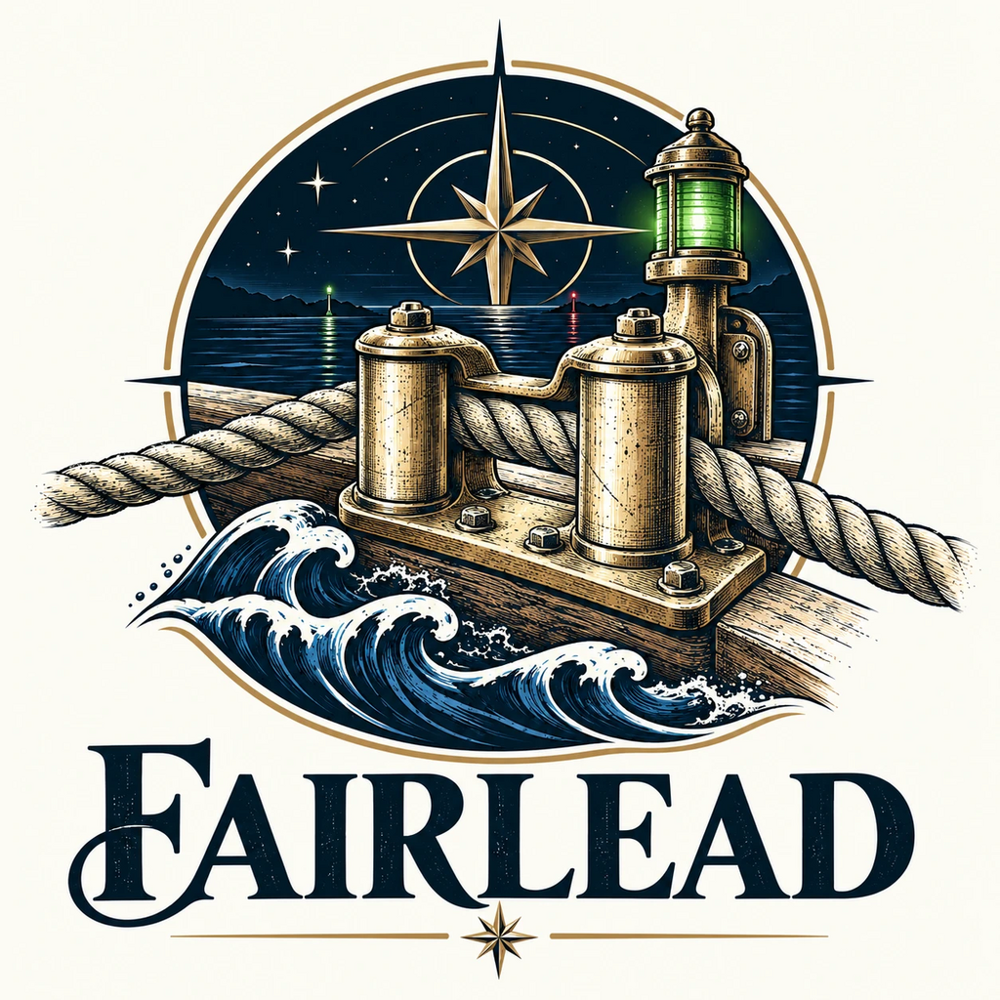
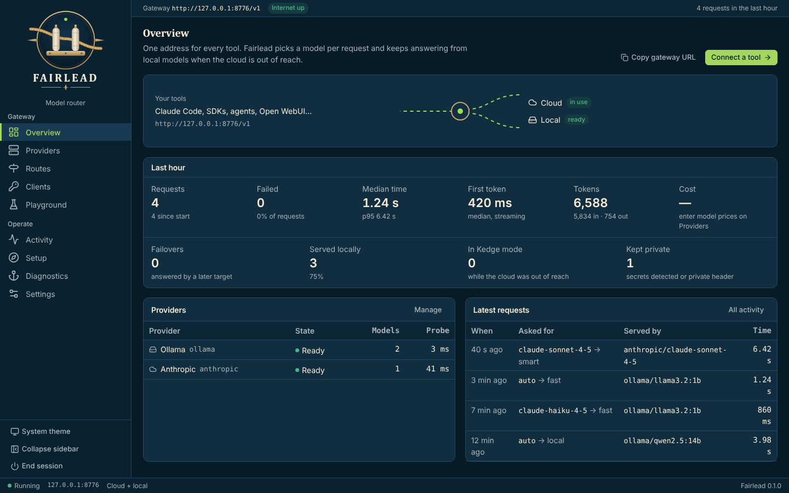
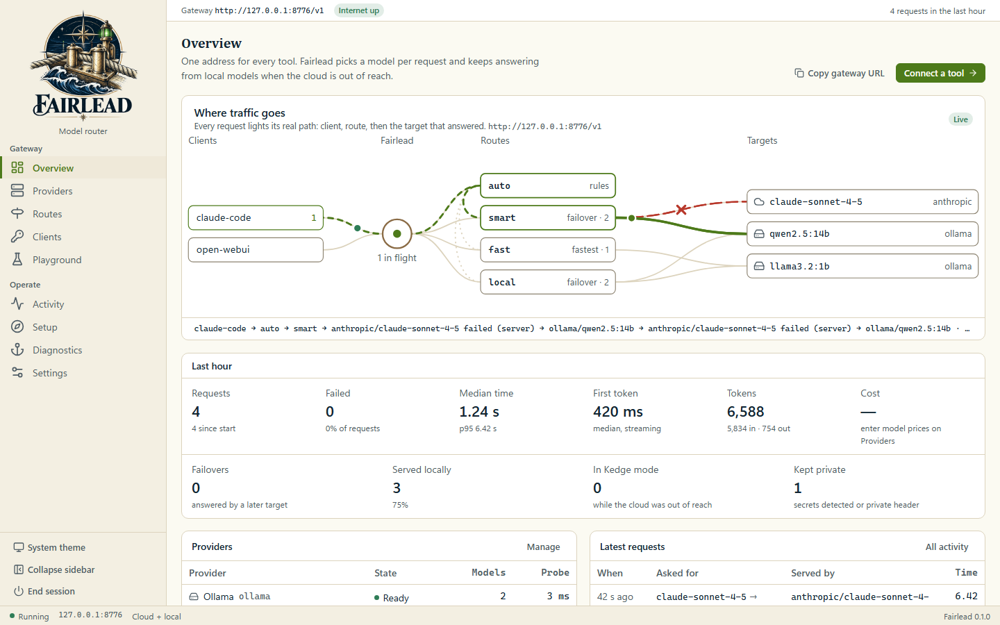

<p align="center">
  <picture>
    <source media="(prefers-color-scheme: dark)" srcset="assets/brand/emblem-dark.png">
    
  </picture>
</p>

# Fairlead

**One local address for every model.** Fairlead is the model router behind the Fleet tools: it speaks the OpenAI
and Anthropic APIs on `http://127.0.0.1:8776`, sends each request to the right cloud or local model, and keeps
answering from local models when the internet or a provider goes down. Set it up once in the browser, then it
runs from the tray.

## The name

A fairlead is the fitting on a deck that takes a line coming from any angle and leads it, without chafe, to the
right winch. Fairlead does that for model traffic: requests come in from any tool and leave on a clean path to the
right model. Its offline mode is called **Kedge mode**: to kedge is to move a ship under its own power when there is
no wind, which is what Fairlead does with local models when the cloud drops away. Fairlead is new; it has no former
names.

| Night watch (dark) | Chart room (light) |
| --- | --- |
|  |  |

The Overview with synthetic demo data: Ollama on this machine, one cloud provider and a few requests
(`docs/screenshots/capture-screenshots.mjs` regenerates both pictures from the built UI with a mocked API).

## What it does

| | |
|---|---|
| **Two APIs in, any model out** | `POST /v1/chat/completions` (OpenAI) and `POST /v1/messages` (Anthropic), streaming or not, with tools and images. Requests are translated when the target speaks the other dialect, and relayed untouched when it speaks the same one. |
| **Routes, not model names** | Tools ask for `auto`, `smart`, `fast` or `local`. Each route tries an ordered list of targets (failover, fastest-first or round-robin). `auto` picks a route per request from rules: prompt size, tools, images, keywords, the calling client. |
| **Hard-coded names still work** | Aliases send `claude-*`, `gpt-*`, `*haiku*`... to routes, so Claude Code and SDK samples work unchanged. `provider/model` always goes straight to that model. |
| **Kedge mode** | A health monitor watches Windows network events, probes the internet and every provider, and switches to local models within seconds of losing the cloud, then back when it returns. It can also be forced on. |
| **Failover and hedging** | Per-provider circuit breakers keep dead targets out of the way; a failed call moves to the next target before any byte reaches the caller. Optional hedging races a second target when the first is slow. |
| **Privacy routing** | Prompts carrying secrets (API keys, private keys, passwords, card numbers) or `X-Fairlead-Privacy: local` never leave the machine. |
| **One-time browser setup** | Finds Ollama, phoenix-lai, LM Studio, llama.cpp, vLLM and Jan on this machine, takes cloud keys (DPAPI-encrypted), suggests routes and hands out client keys with copy-paste setup for each tool. |
| **Visible** | Live overview, per-request decision traces, token counts, latency, cost (from prices you enter), a playground with a dry-run "Explain". |

## Quick start

```powershell
.\Launch-Fairlead.bat           # from a clone or a release zip: tray icon; the setup page opens on first run
```

Then point a tool at it, for example Claude Code:

```powershell
$env:ANTHROPIC_BASE_URL = "http://127.0.0.1:8776"
$env:ANTHROPIC_AUTH_TOKEN = "fl-...your client key..."
claude
```

Any OpenAI SDK: `base_url="http://127.0.0.1:8776/v1"`, `api_key="fl-..."`, `model="auto"`. More tools are in
[`integrations/`](integrations/README.md) and on the Clients page.

Everything the admin page does also works from the command line and over HTTP:

```powershell
.airlead.cmd status                       # or: help, routes set, providers test, clients add, kedge on, chat ...
```

## Privacy and data

Fairlead runs on this PC. A prompt goes only where its route sends it: local models keep it on the machine, and a cloud provider receives it under that provider's terms and your organization's AI policy. Prompts carrying secrets, or marked `X-Fairlead-Privacy: local`, never leave the machine. The request log never holds prompt text; prompt text is kept in memory only while content logging is on. Cloud keys are DPAPI-encrypted, and Fairlead sends no usage data anywhere.

## Documentation

- [Vision: the Fleet's intelligence router](docs/VISION.md): Fairlead as the default for AI endpoints, git repositories and databases; migration inventory and open questions
- [Architecture](docs/ARCHITECTURE.md): components, request path, security
- [Routing and Kedge mode](docs/ROUTING.md): routes, rules, aliases, failover, health
- [AI gateway](docs/AI-GATEWAY.md): Responses API gateways from a model file, with the address and token from the environment
- [Cited answers (Bearing)](docs/BEARING.md): optional, off by default; answers that quote a local folder of documents with a link back
- [Command line](docs/CLI.md): `fairlead.cmd`, one command per capability, for people and scripts
- [API](docs/API.md): the gateway (`/v1`) and every admin route (`/api`)
- [Operations](docs/OPERATIONS.md): running, stopping, config files, troubleshooting
- [Development](docs/DEVELOPMENT.md): build, test, layout, conventions
- [Integrations](integrations/README.md): per-tool setup and the hackathon worklist
- [Roadmap](ROADMAP.md)
- Fleet standards: [TechStack](TechStack), [Unified UI](docs/UNIFIED-UI.md), [Local app lifecycle](docs/LOCAL_APP_LIFECYCLE.md)
