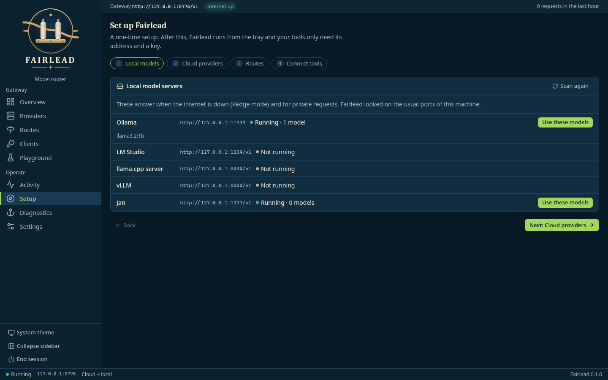
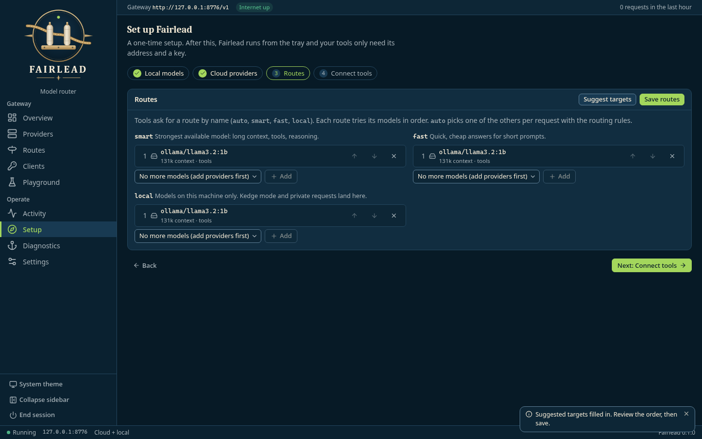
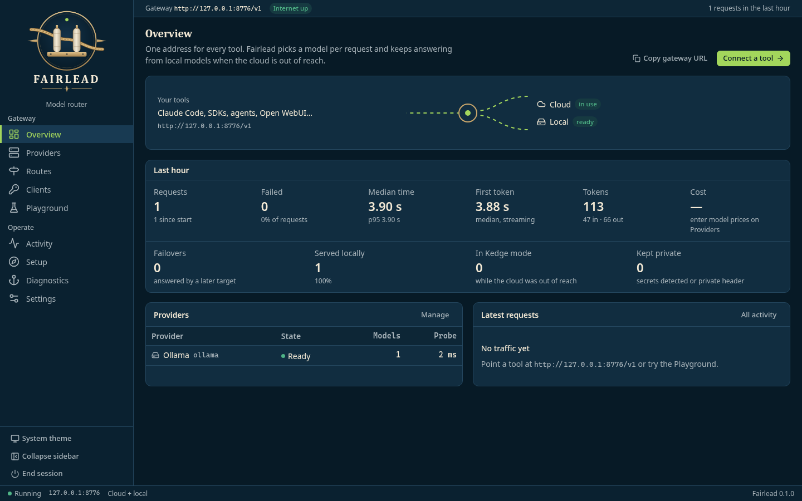
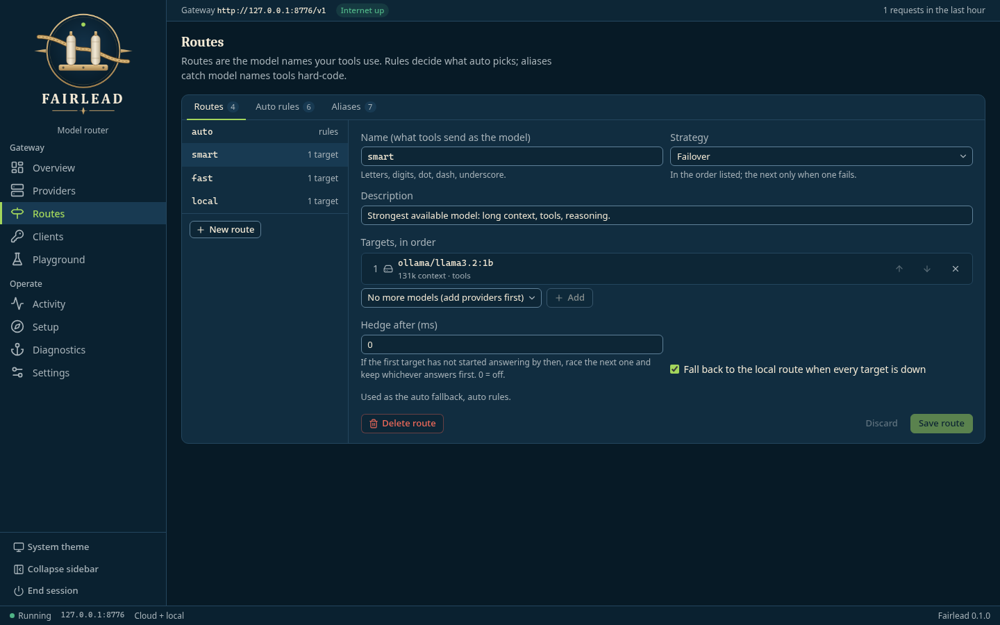
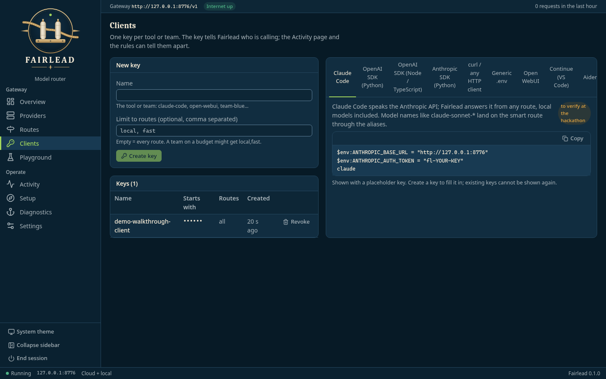
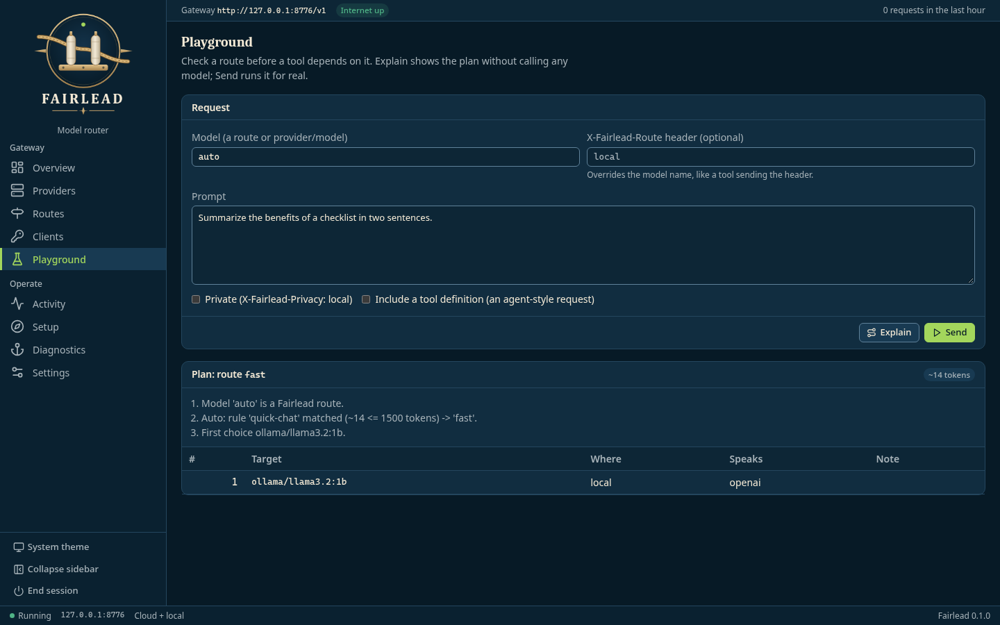
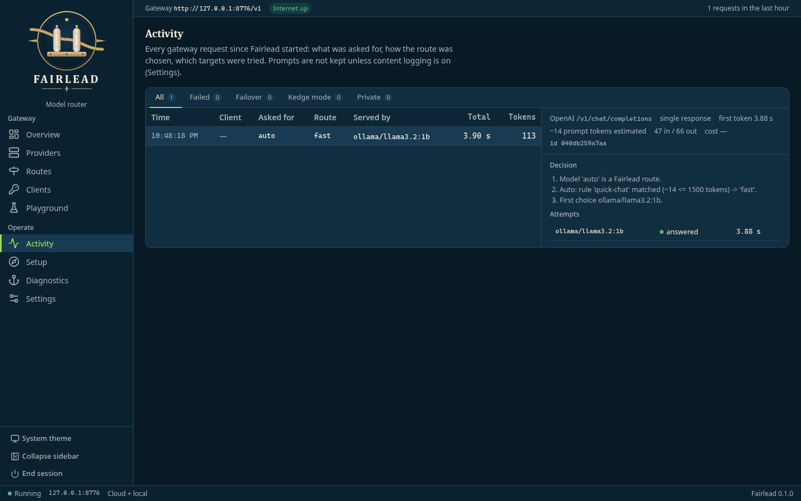

# Fairlead walkthrough

Set up Fairlead once in the browser so every tool can use one local address, `http://127.0.0.1:8776`, for all its models.

> **Screenshots:** captured with demo data and scanned by the Chief of Staff (team directive 10).

## Before you start

- Windows PowerShell 5.1 (part of Windows). No administrator rights and no installer.
- Microsoft Edge or Google Chrome.
- Launch: `build\Build-Fairlead.ps1` once on the build machine, then `.\Launch-Fairlead.bat` (tray icon; the setup page opens on first run).
- Optional: a local model server such as Ollama, or a cloud provider key you are authorized to use.

## Steps

### 1. First launch: Setup

On first run Fairlead opens **Setup** at step 1, *Local models*, and lists the model servers it found on the usual local ports. Select **Use these models** for the ones you want.

### 2. Suggest routes

At the *Routes* step, select **Suggest targets**, check the order of the targets on each route, then **Save routes**. `auto` has no card of its own: it picks one of the other routes per request using the routing rules.

### 3. Watch the overview

**Overview** shows your tools, the last hour's requests, the providers and the latest requests. Until a tool sends traffic, *Latest requests* says *No traffic yet*.

### 4. Check routes

**Routes** lists each route's targets and failover order.

### 5. Add a client

On **Clients**, name a key, optionally limit it to some routes, and select **Create key**. Copy the key straight into your tool: it is shown only once. The tabs on the right give the setup snippet for each tool.

*In this screenshot the key's Starts with prefix is masked for the walkthrough. The app shows the key's first characters there.*

### 6. Try the playground

In **Playground**, type a prompt and select **Explain** to see which route and target would answer, without sending it.

### 7. Read a decision trace

**Activity** lists each request. Select one to see its decision, the targets tried, tokens and timing. Requests sent without a client key show a dash in the *Client* column.

## About these images

Images live in [`docs/assets/walkthrough/`](../assets/walkthrough/), named `NN-<screen>.png` after the step they belong to. They are 1440x900 at 100% scale in the dark (System theme on a dark system) theme, and show demo data only. `node docs/screenshots/capture-screenshots.mjs --walkthrough <dir>` renders the same views from the built UI with a mocked API, for checking them against the app.
